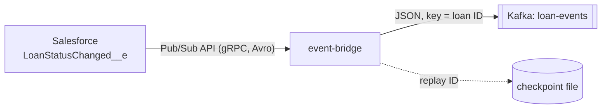

# event-bridge

Subscribes to the Salesforce platform event `LoanStatusChanged__e` over the **Pub/Sub API** (gRPC)
and publishes every event to the Kafka topic `loan-events`, keyed by loan ID.



## How it works

| Concern | Approach |
|---|---|
| Authentication | OAuth 2.0 client credentials of an External Client App. The token response gives the instance URL and the org ID, sent as the `accesstoken`, `instanceurl` and `tenantid` gRPC headers. A rejected token triggers a fresh login. |
| Decoding | Event payloads are Avro. Schemas are fetched once per schema ID with `GetSchema` and cached. |
| Flow control | Requests 100 events at a time and asks for more when Salesforce has none pending. |
| Delivery | At-least-once. The replay ID is saved only after Kafka acknowledged the event. If publishing fails, the stream is cancelled and reopened from the last saved replay ID, so the event is delivered again. Consumers drop duplicates by `eventUuid`. |
| Restarts | Resumes from the saved replay ID. Salesforce keeps platform events for 72 hours. |
| Ordering | Kafka key = loan ID, so all changes to one loan are on one partition, in order. |
| Health | `GET /actuator/health` shows whether the subscription is up, how many events were forwarded and the last error. |

Message on `loan-events`:

```json
{
  "eventUuid": "6f1c2e7a-0b7e-4c1d-9a51-3f0a8c2d1e44",
  "loanId": "a01di00001O3s0jAAB",
  "oldStatus": "Pending_Approval",
  "newStatus": "Approved",
  "amount": 30000.0,
  "applicantEmail": "noam@example.com",
  "occurredAt": "2026-11-06T10:00:00Z",
  "replayId": "AAAAAAAJ0kQ="
}
```

## Salesforce setup (one time)

The bridge logs in as an **External Client App** with the client credentials flow, running as one user.

1. **Setup → External Client App Manager → New External Client App**
   - Name: `Loan Event Bridge`, contact email: yours, distribution state: **Local**.
2. Under **API (Enable OAuth Settings)**, tick **Enable OAuth**:
   - Callback URL: `https://localhost/callback` (required by the form, not used).
   - OAuth scopes: **Manage user data via APIs (api)**.
   - Flow enablement: tick **Enable Client Credentials Flow**.
   - Create.
3. Open the app → **Policies → Edit** → under OAuth Policies, tick **Enable Client Credentials Flow** and set
   **Run As** to your user (it needs read access to `LoanStatusChanged__e`; the `Loan_Officer` permission set
   grants it). Save.
4. **Settings → OAuth Settings → Consumer Key and Secret**: copy both into `../.env` as `SF_CLIENT_ID` and
   `SF_CLIENT_SECRET`.
5. **Setup → My Domain**: copy the *Current My Domain URL* (ends in `.my.salesforce.com`) into `SF_LOGIN_URL`.

Check the credentials before starting the bridge:

```bash
curl -s -X POST "$SF_LOGIN_URL/services/oauth2/token" \
  -d grant_type=client_credentials -d client_id="$SF_CLIENT_ID" -d client_secret="$SF_CLIENT_SECRET"
# expect JSON with access_token, instance_url and id
```

## Run

From the IDE (Kafka from `../docker-compose.yml` on `localhost:9094`):

```bash
export SF_LOGIN_URL=... SF_CLIENT_ID=... SF_CLIENT_SECRET=...
mvn spring-boot:run
```

Or everything in containers: `docker compose up -d --build` in `services/`.

Then change a loan's status in Salesforce and watch the log:

```
Forwarded loan a01di00001O3s0jAAB Pending_Approval -> Approved (event 6f1c2e7a-...)
```

## Tests

`mvn test`. The protobuf and gRPC classes are generated from `src/main/proto/pubsub_api.proto`
(the official file from `forcedotcom/pub-sub-api`) during the build.

| Test | Covers |
|---|---|
| `LoanEventSubscriberTest` | Against an in-process fake of the Pub/Sub API: forwarding, auth headers, LATEST on first start, CUSTOM replay after restart, redelivery after a Kafka failure |
| `EventDecoderTest` | Avro decoding and field mapping, including nulls |
| `FileReplayStoreTest` | Binary replay IDs round-trip; a corrupt file is ignored |
| `ClientCredentialsSessionProviderTest` | Org ID taken from the identity URL |
| `EventBridgeApplicationTest` | Context starts with the subscription switched off |

## Configuration

| Variable | Default | Purpose |
|---|---|---|
| `SF_LOGIN_URL` | none | My Domain URL |
| `SF_CLIENT_ID` / `SF_CLIENT_SECRET` | none | External Client App credentials |
| `KAFKA_BOOTSTRAP_SERVERS` | `localhost:9094` | Kafka |
| `REPLAY_FILE` | `./data/replay-id` | Checkpoint file |
| `SUBSCRIPTION_ENABLED` | `true` | Set to `false` to run without Salesforce |
| `PORT` | `8081` | HTTP port (health) |
